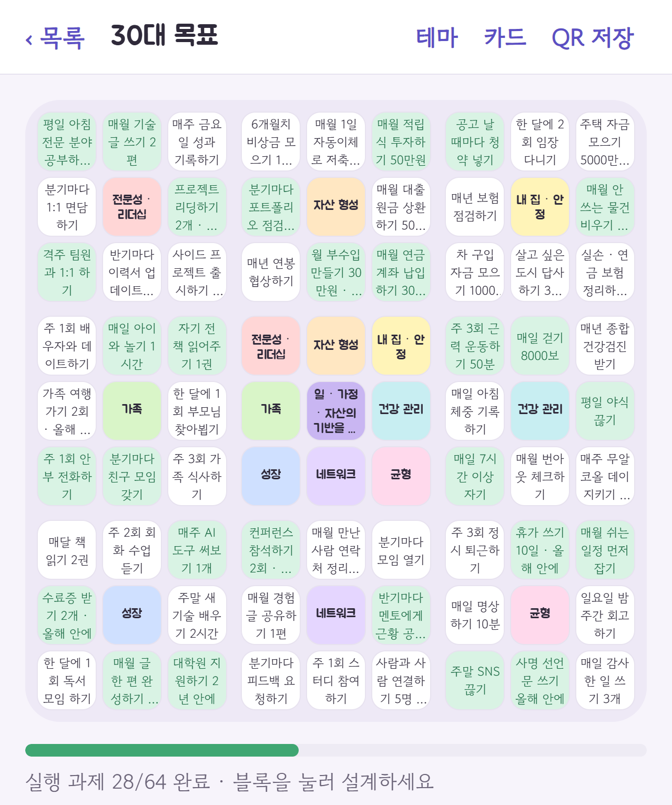
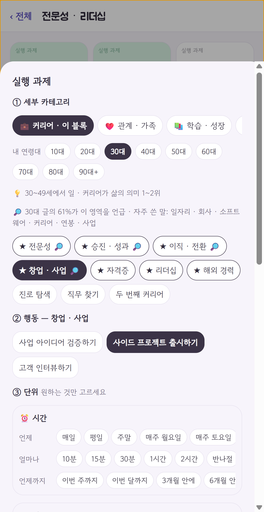
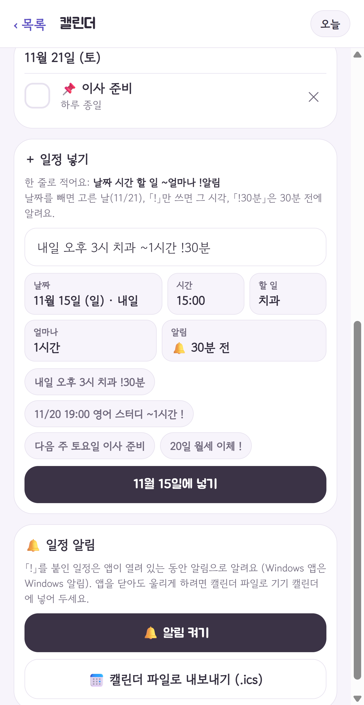
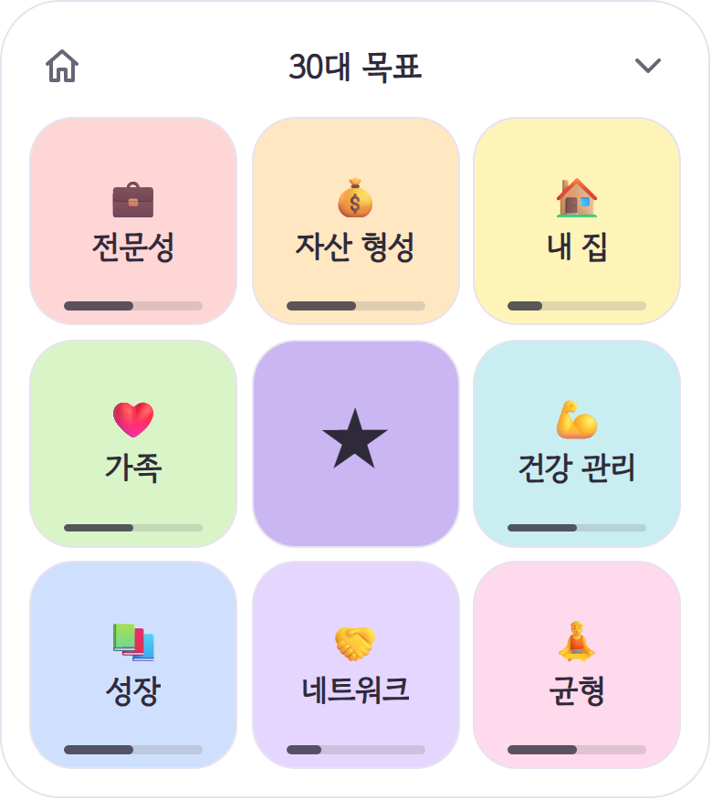

# ★ 구도 GUDO · Nine Ways

**만다라트(9×9 목표표)로 목표를 설계하고 매일 점검하는 크로스플랫폼 앱 — Claude Code(AI 개발 도구)와 함께 만들고 있는 개인 프로젝트입니다.**

👉 웹: https://career-mandalart.vercel.app · 🪟 Windows: [GUDO-Setup.exe](https://github.com/Umkimisstrong/career-mandalart/releases/latest/download/GUDO-Setup.exe)



## 개요

- 큰 목표를 적어 두기만 하고 실행으로 잇지 못하는 문제를 다룹니다. 목표 1개를 세부 목표 8개로, 세부 목표마다 실행 과제 8개(총 81칸)로 쪼갭니다.
- 칸마다 완료 체크와 반복 점검(매일 · 요일 · 매주 · 매월)을 걸고 알림을 받아, 「오늘 할 일」까지 이어 줍니다.
- 서버 · DB · 회원가입 없이 기기 안에만 저장합니다. 데이터는 백업 코드 · QR 이미지로 옮깁니다.
- 코드 하나로 iOS · Android · 웹(PWA)에서 돌아가고, Windows 앱(Electron)도 있습니다.

## 기술 스택

| 영역 | 사용 기술 |
|---|---|
| 앱 | Expo SDK 58 · React Native 0.88 · React 19 · react-native-web |
| 언어 | TypeScript 6 (커밋 전 `tsc --noEmit` 훅) |
| 저장 | AsyncStorage / localStorage — JSON 하나, DB 없음 |
| 기기 기능 | expo-notifications(로컬 알림) · expo-camera(QR 읽기) · react-native-svg |
| QR · 압축 | fflate(deflate) · base45(직접 구현) · qrcode · jsQR |
| Windows | Electron 45 · electron-builder · electron-updater(GitHub 릴리스로 자동 업데이트) |
| 배포 | Vercel(GitHub `main` push 시 자동 배포) · GitHub Releases |

## 구현된 기능

- **목표판**: 크기 1 · 3 · 5 · 7 · 9칸, 전체 화면 ↔ 블록(3×3) 확대, 칸 내용 · 메모 · 완료 체크, 진행률
- **칸 문장 도우미**: 카테고리(매슬로우 6단계 × 11개 영역) → 세부 카테고리 → 행동 + 시간 · 장소 · 수량을 고르면 문장 자동 완성. 연령대별 템플릿 9종
- **반복 점검 · 알림**: 연속 기록 · 달성률 · 28일 기록, 휴대폰 로컬 알림, 캘린더 파일(.ics) 내보내기
- **캘린더**: 「내일 오후 3시 치과 !30분」 같은 한 줄 입력을 날짜 · 시간 · 알림으로 풀어 일정 등록, 완료 체크
- **팀 목표(서버 없음)**: 블록마다 담당자를 정하고, 초대장 · 갱신 코드(링크 · QR)를 주고받아 합침. 담당자는 자기 블록만 고침
- **데이터 옮기기**: 목표 1개 = QR 이미지 1장, 전체 = 백업 코드(같은 id 는 덮어쓰기 병합)
- **테마 · 공유**: 앱 테마 / 목표판 테마 두 층, 퍼즐 그림 테마, 인스타그램용 이미지 카드
- **Windows 앱**: 바탕화면 작은 창(항상 위) · 트레이 · 자동 업데이트

전체 목록과 작업 이력: [FEATURES.md](FEATURES.md)

## 다음 계획

- 사용자 10명에게 써 보게 하고 피드백 받기
- 팀 목표 실행 과제 추천을 균형성과표(BSC)에 맞게 바꾸기 (지금은 개인용 추천이 뜸)
- 실제 iPhone · Android 에서 화면 · 알림 · 카메라 QR 점검
- 일정 알림을 메일 · 알림톡으로 넓히기 (서버가 필요해 아직 설계 단계, [docs/calendar.md](docs/calendar.md))

## 구조

```
career-mandalart/            앱 (Expo)
├─ App.tsx                   화면 전환(상태 기반 route, 라우터 라이브러리 없음) · 자동 저장
├─ src/
│  ├─ model.ts               도메인 모델 — Plan · Cell · Store, 크기별 칸 규칙, 진행률
│  ├─ storage.ts             저장 · 불러오기 · 백업 코드 병합, 형식 버전 검사
│  ├─ routine.ts · calendar.ts · notify(.web).ts · ics.ts   반복 점검 · 일정 해석 · 알림 · .ics
│  ├─ team.ts · qr/          팀 코드 형식 · 받기 규칙 · 권한 / QR 코덱
│  ├─ categories/            카테고리 · 템플릿 데이터
│  ├─ theme.ts               테마 토큰 (화면에 색 하드코딩 금지)
│  └─ components/ · screens/ 공용 UI · 화면
└─ desktop/                  Windows 앱 (Electron main · preload · updater)
docs/                        기능별 근거 · 결정 문서
```

- **도메인 로직(`model` · `routine` · `calendar` · `team` · `qr`)은 화면과 분리된 순수 함수**이고, 화면은 그 결과만 그립니다.
- 플랫폼 차이는 파일 이름으로 나눕니다 (`notify.ts` / `notify.web.ts`, `image.web.ts`).
- 저장 형식을 바꾸면 `version` 을 올리고 옮기기 코드를 넣고, QR · 팀 코드는 예전 코드를 계속 읽도록 뒤에만 덧붙입니다.

## AI 협업 방식

이 프로젝트는 Claude Code 로 코드를 만들고, 저는 무엇을 만들지 정하고 결과를 확인하는 역할을 맡았습니다.

1. **요구사항 정리** — 기능마다 범위와 제약을 먼저 정합니다. 정한 내용은 날짜와 함께 [CLAUDE.md](CLAUDE.md) 결정 표에, 근거는 `docs/*.md` 에 남깁니다.
   예) 「일정은 목표 칸과 연결하지 않는다」 · 「팀 목표는 서버 없이 코드 주고받기로」 · 「Vercel 무료 플랜만」.
   AI 가 지킬 규칙(세부 목표는 `getCell` / `setCell` 로만, 색 하드코딩 금지, 저장 형식 버전 관리 등)은 [AGENTS.md](career-mandalart/AGENTS.md) 에 둡니다.
2. **구현 요청** — 기능 단위로 요청하고, 문서 정리처럼 서로 겹치지 않는 일은 세션을 나눠 동시에 진행합니다.
3. **검토 · 수정** — 결과를 실제 앱에서 써 보고, 기대와 다른 동작이나 바꿀 점을 다시 요청해 고칩니다. 바뀐 내용은 [FEATURES.md](FEATURES.md) 작업 이력에 커밋 해시와 함께 남깁니다.
4. **테스트** — 단위 테스트 프레임워크는 아직 없습니다. 대신 다음 순서로 확인합니다.
   - 커밋 전 타입 검사(`.githooks/pre-commit`, 실패하면 커밋 중단)
   - 웹 빌드를 격리된 Electron 창에 띄우고 사용자처럼 누르고 입력해 화면을 캡처하는 검증 스크립트 (개인 PC 전용, 저장소에는 없음)
   - 아직 못 한 것: 실제 휴대폰 화면 · 휴대폰 알림 · 카메라 QR

## 실행 방법

필요 환경: Node.js 22.13 이상

```bash
git clone https://github.com/Umkimisstrong/career-mandalart.git
cd career-mandalart/career-mandalart
npm install
npx expo start        # Expo Go 로 휴대폰 실행, w = 웹
npm run typecheck     # 타입 검사
npm run build:web     # dist/ 에 웹 + PWA 빌드
```

Windows 앱 빌드는 [career-mandalart/README.md](career-mandalart/README.md#windows-앱-desktop) 참고.

## 스크린샷

| 칸 문장 도우미 | 캘린더 한 줄 입력 | Windows 작은 창 |
|:-:|:-:|:-:|
|  |  |  |
| 카테고리 → 행동 → 단위를 고르면 문장 완성 | 「내일 오후 3시 치과 !30분」을 날짜 · 시간 · 알림으로 | 바탕화면에 띄워 두는 목표 창 |

<sub>화면은 연령대 템플릿(30대)으로 만든 예시 목표입니다.</sub>
